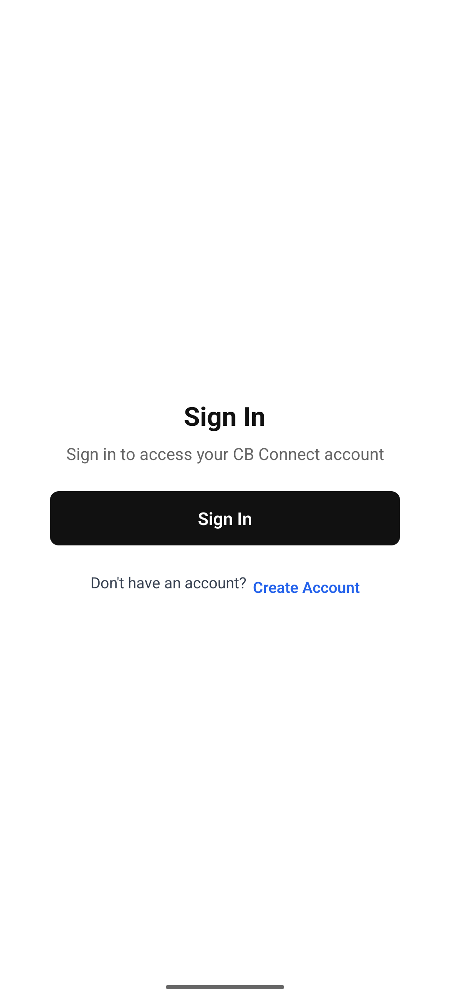

# Gate 5 M2 Android session evidence — 2026-10-26

**Status: M2 test compromise accepted; M3 may proceed, foundation is not freeze-ready.** At the owner's direction, qualification uses only the approved `holy-clam-29` Clerk development instance and `dev:hallowed-hummingbird-284` Convex test deployment. The first-instance lifecycle is live-tested; app configuration rejects other Clerk issuers in deterministic tests. Production was not queried or changed.

## Verified

- Pixel 7 / Android 17 debug app completed Clerk hosted sign-in for a run-scoped synthetic primary account. Clerk's active session issued a Convex JWT whose issuer and subject matched the approved test issuer and fixture account.
- Convex accepted that JWT for `ensureUser`, `getMe`, and `getCapabilities`. A newly issued JWT for the same active session was also accepted.
- The app's sign-out action returned to the sign-in screen. Clerk reported the primary session revoked; signing in as the second synthetic fixture account created a different active session. That account received no primary `getMe` or guard data, and `getCapabilities` failed closed.
- Convex fixture cleanup reported no remaining scoped records. Both Clerk fixture users were deleted, and both sessions were inactive.
- Local checks after the sign-out and Expo patch updates: mobile tests 12 files / 55 tests passed; mobile typecheck and contracts parity passed; `expo-doctor` passed 21/21 checks.
- The mobile auth environment test rejects a second development issuer and the production issuer `clerk.cb.builtbynaki.tech`; these are publishable-key/configuration boundary tests, not signed foreign-JWT integration tests.
- A separate short-lived backend-created session in the same Clerk development instance minted a JWT with the expected `iss`, `sub`, `aud`, and expiration. Convex accepted it under the approved provider configuration. The session and synthetic Clerk user were deleted after the check.
- A one-instance provider mismatch attempt changed the configured URL only by adding a trailing slash. Convex still accepted the JWT, so this did **not** prove issuer rejection. The exact provider URL was restored, the temporary diagnostic query was removed from the deployment, and no application data was created.

The screenshot records the app after the second fixture signed out. It contains no fixture email, password, token, or verification code.

## Issuer proof limit

The earlier negative token check changed the `iss` claim without re-signing the JWT. Convex rejected that tampered token, which does not prove rejection of a valid JWT signed by a foreign issuer. Clerk documents `iss` as an instance Frontend API URL claim that JWT templates cannot override. Using only `holy-clam-29` cannot mint a valid token with another issuer; Convex also canonicalized the trailing-slash variant and accepted the first-instance token. No production issuer was used. Per the owner's approved compromise, M3 proceeds with the app-side issuer/configuration gate and this gap remains explicit: **a valid foreign-signed JWT rejection was not tested**. This compromise does not support a claim that Convex rejected such a token.

## M3 route-shell implementation and local evidence — 2026-10-26

- Backend `mobileAccess.getGuardState` now has a focused Convex test covering primary and partner role responses, then partner access changing to `isLinked: false` after the primary revokes the relationship.
- Route-state tests cover signed-out, auth pending/rejected, offline, stale backend state, incomplete onboarding, unlinked/revoked relationships, role mismatch, and backend-confirmed primary/partner access. The shell/error/offline tests assert generic accessible copy and prevent sensitive data from reaching the fallback.
- Pixel 7 / Android 17 emulator displayed the signed-out Clerk screen. Screenshot: [android-m3-signed-out-gate.png](./android-m3-signed-out-gate.png). No credentials or fixture identity are visible.
- Local validation after these changes: root unit tests 79 files / 904 tests; mobile tests 12 files / 56 tests; mobile and root typechecks; contract parity; Expo Doctor 21/21; Android Metro export (1,497 modules); CI workflow, fixture boundary and Convex command policy checks; root production build with the repository's inert qualification environment; root `npm audit --omit=dev` reports zero vulnerabilities.
- This is local unit, backend-test, and signed-out emulator evidence. No authenticated M3 route-shell interaction was performed on the emulator in this pass, and an iOS simulator is unavailable on this host.
- Mobile `npm audit --omit=dev` still reports six high findings in `node-forge` and `zod` through Expo tooling; npm reports no available fix. This remains an open dependency risk for freeze review.

**M3 status: implementation and local checks pass; exact-SHA independent reviews and remote CI remain pending. Foundation is not freeze-ready.**

## Audit findings

- Root `npm audit --omit=dev` initially found critical/high Next.js advisories at 15.5.27. The web dependency is now pinned by the lockfile to patched Next.js 15.5.28; local audit reports zero vulnerabilities.
- Mobile `npm audit --omit=dev` still reports high-severity `node-forge` and `zod` advisories through Expo tooling, with no fix available in the current dependency tree.
- After the Next.js patch, local root validation passed: `npm run typecheck`, `npm run test:unit -- --run` (78 files / 903 tests), and the CI-style `npm run build`. These ran on Node 22.23.1; PR CI remains the required check under pinned Node 20.19.1 / npm 10.8.2.

The remaining mobile audit findings require disposition before a foundation freeze. No broad `npm audit fix` was used.
